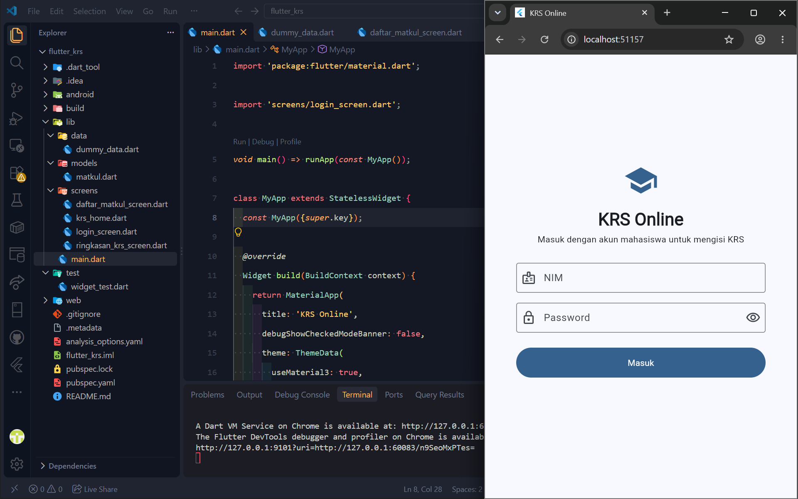
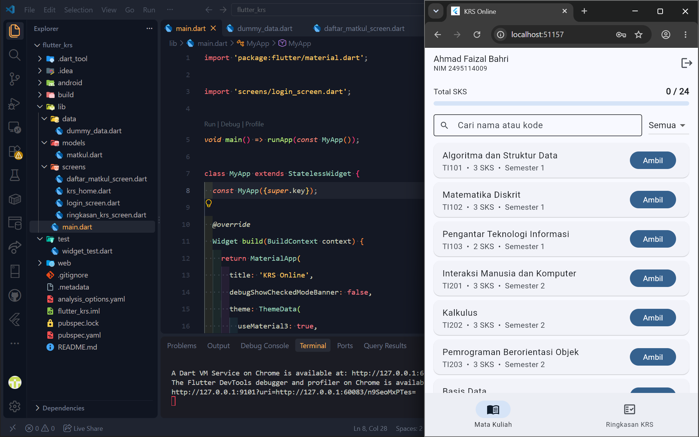
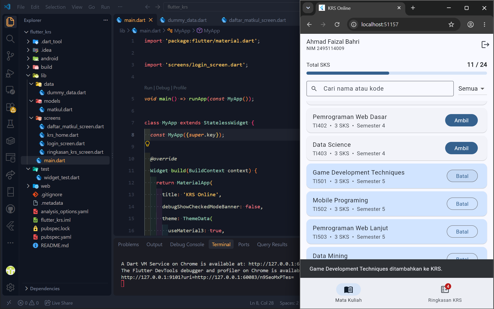
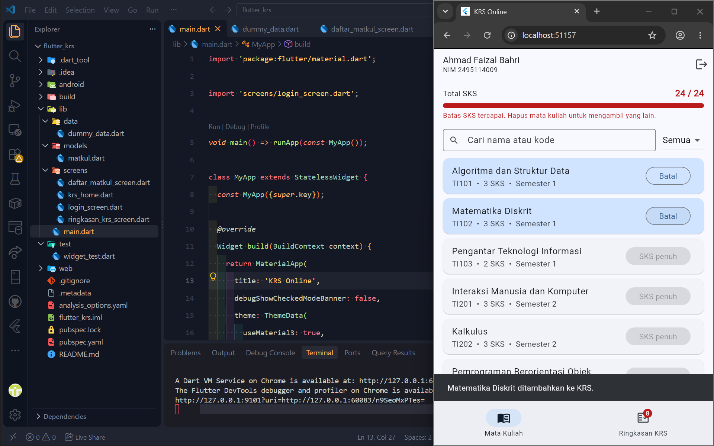
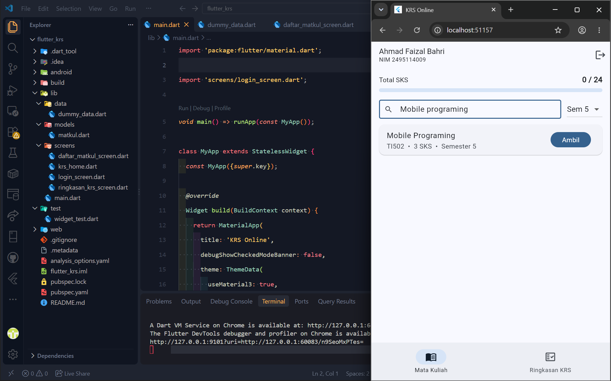
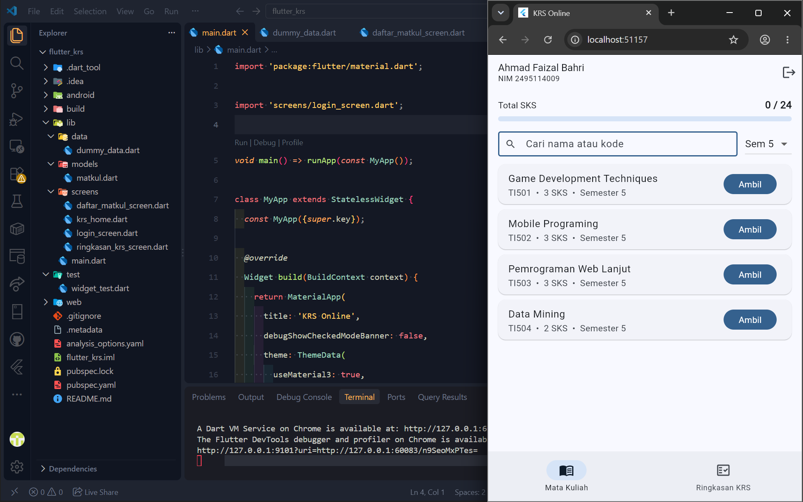
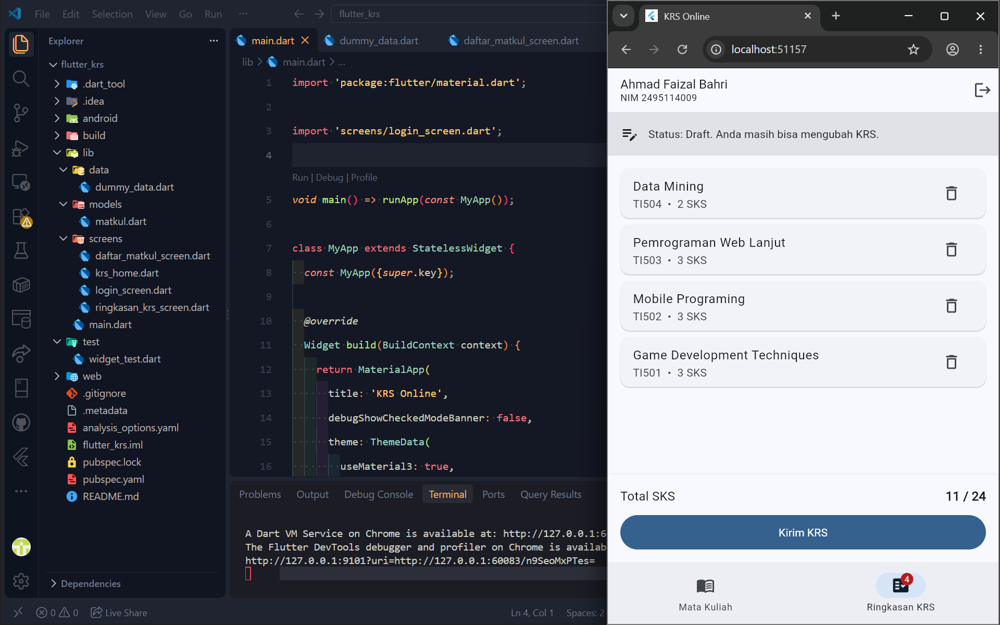
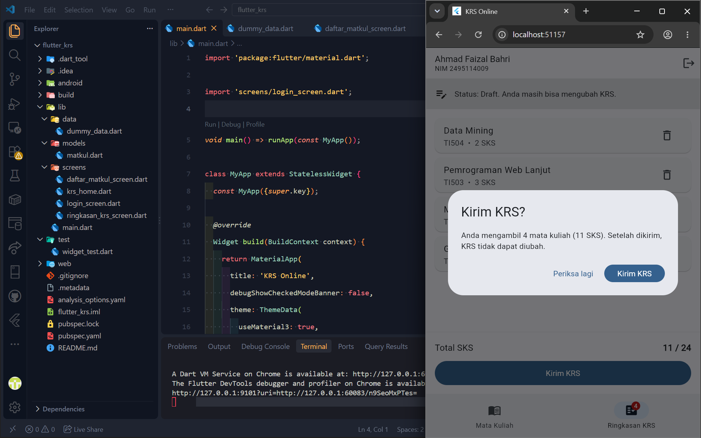
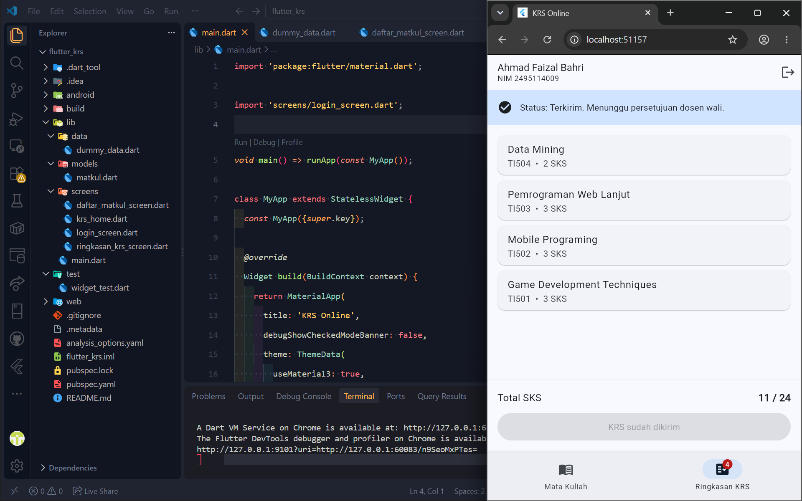

# KRS Online (Flutter)

Aplikasi simulasi pengisian Kartu Rencana Studi (KRS) untuk studi kasus sistem kampus.
Dibuat untuk mendemonstrasikan **State** dan **Interaksi Pengguna** di Flutter.

## Fitur
- Login dengan validasi form dan indikator loading
- Daftar mata kuliah dengan pencarian dan filter semester
- Ambil dan batalkan mata kuliah, total SKS dihitung otomatis
- Batas maksimal 24 SKS (tombol dinonaktifkan dan muncul peringatan)
- Ringkasan KRS, hapus mata kuliah, kirim KRS dengan dialog konfirmasi
- Setelah terkirim, KRS terkunci

Akun demo: **NIM 2495114009**, **password mahasiswa123**

## State yang digunakan (setState)
| State | Lokasi | Fungsi |
|---|---|---|
| `_sembunyikanPassword`, `_sedangMemuat`, `_pesanError` | `login_screen.dart` | Tampilan form login |
| `_dipilih` | `krs_home.dart` | Daftar mata kuliah yang diambil |
| `_terkirim` | `krs_home.dart` | Status KRS (draft/terkirim) |
| `_tabAktif` | `krs_home.dart` | Tab yang sedang dibuka |
| `_totalSks` (turunan) | `krs_home.dart` | Dihitung dari `_dipilih` |
| `_kataPencarian`, `_semesterDipilih` | `daftar_matkul_screen.dart` | Pencarian dan filter |

State bersama diletakkan di widget induk (`KrsHome`) lalu diteruskan ke halaman anak lewat parameter dan callback (*lifting state up*).

## Struktur
```
lib/
├── main.dart
├── models/matkul.dart
├── data/dummy_data.dart
└── screens/
    ├── login_screen.dart
    ├── krs_home.dart
    ├── daftar_matkul_screen.dart
    └── ringkasan_krs_screen.dart
```

## Screenshots










---